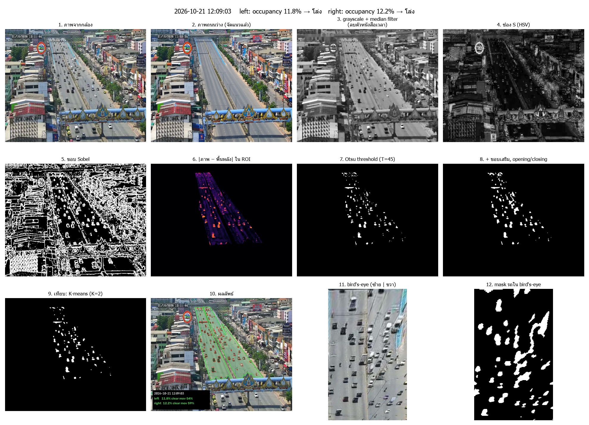

# ระบบตรวจความหนาแน่นจราจรจากกล้อง CCTV เทศบาลนครรังสิต

## เว็บ Dashboard

มีหน้าเว็บธีม Cyber Brutalism สำหรับดูภาพกล้องล่าสุด ผลแยกสองฝั่ง กราฟแนวโน้ม Heatmap ประวัติและรายละเอียดทุกคอลัมน์ พร้อมส่งออก CSV และอัปเดตอัตโนมัติผ่าน SSE

```powershell
python -m pip install -r requirements-web.txt
python run_dashboard.py
```

หรือดับเบิลคลิก `run_dashboard.bat` หลังติดตั้ง dependency แล้ว เว็บจะเปิดที่ **http://127.0.0.1:8000** และเริ่ม worker เก็บ/วิเคราะห์ภาพให้ด้วย กด **Ctrl+C** ในหน้าต่างที่รันเพื่อหยุดทั้งระบบ

รอบแรกจะนำ `results/occupancy.csv` เข้า SQLite อัตโนมัติถ้าฐานข้อมูลยังว่าง จากนั้นใช้ `results/traffic.db` เป็นข้อมูลหลักของเว็บ ผลใหม่เข้าฐานข้อมูลโดยตรง ดาวน์โหลด CSV ได้จากปุ่มบนเว็บ ส่วน CSV เดิมยังอยู่

**ไม่ต้องเปิด `run_collector.bat` หรือ `collector.py` พร้อมกับ dashboard** เพราะ worker เก็บภาพให้อยู่แล้ว หน้าเว็บอัปเดตเมื่อผลวิเคราะห์ใหม่พร้อม ส่วนรอบข้อมูลยังเป็นทุก 5 นาทีและมีเวลารอภาพคู่ตามเดิม

หาก collector เดิมเปิดค้างอยู่แล้ว ใช้ `run_dashboard_existing.bat` หรือ `python run_dashboard.py --watch-only` เพื่อวิเคราะห์และแสดงภาพจากตัวเดิมโดยไม่เปิดตัวเก็บภาพซ้อน

อ่านวิธีใช้ ตัวเลือก LAN การนำเข้าซ้ำ และการทดสอบใน [DASHBOARD.md](DASHBOARD.md)

มินิโปรเจกต์ Image Processing ระบบดึงภาพนิ่งจากกล้อง CCTV ตามรอบเวลา แล้วแยกพิกเซล **รถ** ออกจาก **ถนน**
โดยเทียบกับภาพถนนว่าง (`image_reference/when_clear_road.png`) จากนั้นคำนวณ **occupancy**
(สัดส่วนพื้นที่ถนนที่รถครอบครอง) ของแต่ละฝั่ง แบ่งเป็นระดับ **โล่ง / ปานกลาง / ติด** และสรุปว่าช่วงไหนของวันรถติด



## โครงสร้าง

```
MiniProject/
├── config.py          # ค่าตั้งต้นทั้งหมด: URL, ROI, threshold, เกณฑ์ระดับ
├── collector.py       # ① ดึงภาพทุก 5 นาที (+ ภาพคู่สำหรับวัดการเคลื่อนไหว)
├── run_collector.bat  #    ดับเบิลคลิกเพื่อเริ่มเก็บภาพบน Windows
├── preprocess.py      # ② ลบตัวหนังสือเวลา, grayscale, median filter, histogram, brightness
├── geometry.py        # ③ ROI, จัดแนวภาพอ้างอิง (ORB+homography), template matching, bird's-eye
├── roi_tool.py        #    วาด/ดู ROI แต่ละเลน -> masks/*.png
├── segment.py         # ④ ภาพพื้นหลัง (reference / temporal median), absdiff + Otsu, K-means
├── features.py        # ⑤ morphology, Sobel edge, ช่อง S ของ HSV, motion จากภาพคู่
├── pipeline.py        # ⑥ รวมทุกขั้น -> occupancy ต่อเลน -> ระดับ
├── analyze.py         # ⑦–⑧ ประมวลผลทุกภาพ -> CSV -> กราฟ 24 ชม., heatmap, overlay, summary
├── label_tool.py      #    ติดป้ายระดับด้วยตาคน (ground truth)
├── evaluate.py        #    confusion matrix, accuracy, หาเกณฑ์ที่ดีที่สุด
├── demo_steps.py      #    ภาพอธิบายทีละขั้นสำหรับรายงาน/สไลด์
├── image_reference/when_clear_road.png   # ภาพถนนว่าง (เตรียมเอง)
├── data/raw/YYYY-MM-DD/HHMMSS.jpg        # ภาพจากกล้อง (HHMMSS_b.jpg = ภาพคู่)
├── data/background/bg_day.png            # ภาพถนนว่างที่จัดแนวกับกล้องแล้ว
├── masks/                                # ROI ที่วาดเอง left.png, right.png, rois.json (ใช้แทนค่าใน config.py)
└── results/
    ├── occupancy.csv   summary.txt   labels.csv
    ├── charts/         timeline_24h, heatmap_hourly, levels_by_hour, threshold_vs_kmeans, confusion_matrix, pipeline_steps
    └── overlays/       ภาพผลลัพธ์ทุกเฟรม
```

## ติดตั้ง

```bash
pip install -r requirements.txt
```

## ขั้นตอนใช้งาน

**1. เริ่มเก็บภาพ (ปล่อยรันอย่างน้อย 1 วันเต็ม)**

```bash
python collector.py
```

หรือดับเบิลคลิก `run_collector.bat` ภาพจะถูกเก็บที่ `data/raw/<วันที่>/` ทุก 5 นาที (ประมาณ 288 รอบ/วัน)
ถ้าปิดเครื่องหรือเน็ตหลุด สคริปต์จะข้ามรอบนั้นแล้วทำงานต่อ ตั้งให้รันเองตอนเปิดเครื่องได้ใน Windows Task Scheduler

**2. สร้างภาพพื้นหลัง (ทำครั้งเดียว หลังมีภาพจากกล้องอย่างน้อย 1 ภาพ)**

```bash
python segment.py --reference
```

ภาพ `image_reference/when_clear_road.png` มีขนาด 1408×1117 ไม่เท่ากับภาพกล้อง (720×576)
คำสั่งนี้ย่อภาพแล้วหาจุดเด่น ORB ที่ตรงกันกับภาพกล้อง (~1,000 จุด) แล้ว warp ด้วย homography ให้ทับกันพอดี

หลังเก็บภาพครบ 1 วัน สร้างภาพพื้นหลังกลางคืนด้วย temporal median (กลางคืนจะใช้ภาพนี้อัตโนมัติ):

```bash
python segment.py --median
```

**3. วาด ROI เอง (ใช้กับทุกภาพอัตโนมัติ)**

```bash
python roi_tool.py --draw
```

หน้าต่างจะเปิดภาพถนนว่างให้คลิกจุดรอบเลน left แล้วต่อด้วย right (เส้นของเลนอื่นแสดงให้เห็นแนว)
คลิกซ้าย = เพิ่มจุด, คลิกขวา/`z` = ลบจุดล่าสุด, `r` = เริ่มใหม่, Enter = บันทึก, Esc = ข้ามเลนนี้, `+`/`-` = ซูม
ผลจะถูกบันทึกที่ `masks/left.png`, `masks/right.png` และ `masks/rois.json` ซึ่งทุกสคริปต์อ่านแทนค่าใน `config.py`
จากนั้นประมวลผลทุกภาพใหม่ด้วย ROI ใหม่:

```bash
python analyze.py --redo --all
```

- วาดเฉพาะเลนเดียว: `python roi_tool.py --draw left`
- วาดบนภาพที่มีรถ: `python roi_tool.py --draw --image data/raw/2026-10-21/113952.jpg`
- ดูผล: `python roi_tool.py --preview` → `results/roi_preview.jpg`
- กลับไปใช้ค่าเดิม: `python roi_tool.py --reset`
- ระบายเองใน Paint/Photoshop: `python roi_tool.py --export-template` ได้ภาพพื้น 720×576
  ระบายพื้นที่ถนนเป็นสีขาว ที่เหลือเป็นสีดำ แล้วบันทึกเป็น `masks/left.png` หรือ `masks/right.png`

**4. ประมวลผลและสร้างกราฟ**

```bash
python analyze.py --all
```

รันซ้ำได้เรื่อย ๆ ระบบจะประมวลผลเฉพาะภาพใหม่ ถ้าแก้ ROI/threshold ให้ใช้ `--redo --all`

**5. วัดผล**

```bash
python label_tool.py --limit 100
```

```bash
python evaluate.py
```

ติดป้ายด้วยตาประมาณ 100 ภาพ (กด 1/2/3) แล้ว `evaluate.py` จะสร้าง confusion matrix และแนะนำเกณฑ์ occupancy
ที่ให้ accuracy สูงสุด นำค่าที่ได้ไปแก้ `OCC_MODERATE`, `OCC_CONGESTED` ใน `config.py`

**ภาพประกอบรายงาน:**

```bash
python demo_steps.py data/raw/2026-10-21/113952.jpg
```

## วิธีการ (pipeline)

| ขั้น | ทำอะไร | ไฟล์ | สัปดาห์ |
|---|---|---|---|
| 1 | ดึง snapshot ทุก 5 นาที + ภาพถัดไป (~60 วิ) สำหรับวัดการเคลื่อนไหว | `collector.py` | – |
| 2 | ลบตัวหนังสือเวลาด้วย inpainting → grayscale → median filter 5×5 | `preprocess.py` | W1, W3 |
| 3 | จัดแนวภาพถนนว่างกับกล้อง (scaling + ORB + homography) | `geometry.py` | W7 |
| 4 | ตรวจกล้องขยับ: template matching ซุ้มประตูเมือง → เลื่อนภาพกลับ (translation) | `geometry.py` | W7, W8 |
| 5 | ปรับแสงพื้นหลังให้ตรงกับภาพปัจจุบัน (linear contrast stretching จากพื้นที่อาคาร) | `preprocess.py` | W2 |
| 6 | absdiff ของ grayscale และช่อง S (HSV) กับพื้นหลัง | `segment.py` | W5 |
| 7 | Otsu threshold บนพิกเซลใน ROI (บีบช่วง 22–60) | `segment.py` | W2, W9 |
| 8 | เติมรถสีเทาด้วยขอบ Sobel ที่ไม่มีในพื้นหลัง | `features.py` | W4 |
| 9 | opening ลบจุดรบกวน → closing อุดรูในตัวรถ | `features.py` | W6 |
| 10 | occupancy แยกช่วง ไกล/กลาง/ใกล้ แล้วเฉลี่ยน้ำหนักเท่ากัน (ชดเชย perspective) | `pipeline.py` | W7 |
| 11 | เทียบวิธี K-means (K=2) บนเวกเตอร์ [diff gray, diff S, edge] | `segment.py` | W9 |
| 12 | motion = สัดส่วนพิกเซลรถที่เปลี่ยนระหว่างภาพคู่ | `features.py` | W1 |
| 13 | แบ่งระดับ + บันทึก CSV + กราฟ + overlay | `pipeline.py`, `analyze.py` | – |

**กฎแบ่งระดับ** (`pipeline.classify`)

- occupancy < 20% → **โล่ง**
- occupancy > 45% → **ติด** ยกเว้น motion > 65% (รถเยอะแต่ยังไหลดี) → ปานกลาง
- อยู่ระหว่างนั้น → **ปานกลาง** ยกเว้น motion < 35% (รถจอดนิ่ง) → ติด

เกณฑ์ทั้งหมดเป็นค่าเริ่มต้น ให้ปรับจากผล `evaluate.py`

## คอลัมน์ใน `results/occupancy.csv`

| คอลัมน์ | ความหมาย |
|---|---|
| `timestamp`, `file`, `lane` | เวลา (ตามเครื่องที่เก็บภาพ), ไฟล์, เลน `left`/`right` |
| `occupancy` | occupancy หลังชดเชย perspective (ใช้ตัดสินระดับ) |
| `occupancy_raw` | พิกเซลรถ ÷ พิกเซลถนน แบบไม่ถ่วงน้ำหนัก |
| `occ_far`, `occ_mid`, `occ_near` | occupancy แยกช่วงไกล/กลาง/ใกล้ |
| `occupancy_kmeans` | occupancy จากวิธี K-means (ใช้เปรียบเทียบ) |
| `edge_density` | สัดส่วนพิกเซลขอบ Sobel ใน ROI |
| `motion` | สัดส่วนพิกเซลรถที่เปลี่ยนระหว่างภาพคู่ (ว่าง = ไม่มีภาพคู่) |
| `brightness`, `contrast`, `is_night` | ความสว่างเฉลี่ย, ส่วนเบี่ยงเบนมาตรฐาน, ธงกลางคืน |
| `threshold` | ค่า threshold ที่ Otsu เลือก |
| `cam_dx`, `cam_dy`, `cam_score` | ผล template matching ตรวจกล้องขยับ |
| `level` | `clear` / `moderate` / `congested` |

## สิ่งที่พบระหว่างทำ

- ลิงก์ snapshot redirect ไปยัง `s90.ipcamlive.com/.../snapshot.jpg` และ **อัปเดตนาทีละครั้ง** ภาพคู่สำหรับวัดการเคลื่อนไหว
  จึงห่างกัน ~60 วินาที (ไม่ใช่ 15 วินาทีตามแผนเดิม) และ collector ข้ามภาพที่ซ้ำกับรอบก่อน (กล้องค้าง)
- นาฬิกาที่กล้องประทับในภาพเดินเร็วกว่าเวลาจริงประมาณ 2–3 นาที ระบบจึงใช้เวลาของเครื่องที่ดึงภาพ
- ภาพอ้างอิงมีโทนสี/ความคมต่างจาก snapshot จึงต้องปรับแสงพื้นหลังทุกเฟรมก่อน absdiff
- ป้ายคร่อมถนนช่วงบน (y≈110–120) ทำให้เกิดผลต่างปลอม ROI จึงเริ่มที่ y=125

## ข้อจำกัด

- **กลางคืน:** ไฟหน้ารถ/แสงน้อยทำให้ผลเพี้ยน ใช้ `brightness` ติดธง `is_night` และควรสร้าง `bg_night.png`
- **เงา:** เงารถและเงาอาคารช่วงเช้า/เย็นถูกนับเป็นรถบางส่วน (ภาพอ้างอิงถ่ายช่วงเที่ยง)
  แก้ได้ด้วย `segment.py --median` แล้วตั้ง `BG_DAY_FILE = "bg_day_median.png"`
- **ฝนตก/ถนนเปียก:** ถนนมีเงาสะท้อน ความสว่างเปลี่ยนทั้งเลน
- **รถไกลกล้อง:** รถช่วงบนเล็กมาก closing อาจรวมหลายคันเป็นก้อนเดียว
- **กล้องหมุน/ซูม:** ตรวจได้จาก `cam_score` ต่ำ แต่ระบบแก้ให้เฉพาะการเลื่อน ถ้าซูม/หมุนต้องรัน `segment.py --reference` และวาด ROI ใหม่

## แบ่งงาน 5 คน

| คน | ไฟล์ที่รับผิดชอบ | เนื้อหา |
|---|---|---|
| 1. ข้อมูลและเรขาคณิต | `collector.py`, `geometry.py`, `roi_tool.py` | W1, W7, W8 |
| 2. Preprocessing | `preprocess.py` | W1, W2, W3 |
| 3. Segmentation หลัก | `segment.py` | W2, W9 |
| 4. Feature และ Morphology | `features.py` | W4, W5, W6 |
| 5. วัดผลและสรุป | `pipeline.py`, `analyze.py`, `evaluate.py`, `label_tool.py` | W1, W2 |

interface กลาง: `preprocess(img) -> gray` · `segment(img, bg, mask) -> binary` · `occupancy(binary, mask) -> float`
